# StandarGraph

[](https://github.com/miralabs-tech/standargraph/actions/workflows/ci.yml) [](https://www.npmjs.com/package/@miralabs-tech/standargraph) [](./LICENSE) [](https://nodejs.org)

> "Diagrammes de graphes et de séquences déclaratifs à partir de JSON, rendus en SVG, HTML interactif, PNG et PDF, avec WebGL au-delà de 2000 nœuds."

📖 [English](./README.md) · Français

[Démarrage rapide](#-démarrage-rapide) · [Installation](#-installation) · [Fonctionnalités](#-fonctionnalités) · [Limites](#-limites) · [Cœur headless](./docs/headless.md) · [Benchmark](./docs/bench.md) · [Changelog](./CHANGELOG.md)

[](./docs/assets/architecture.html)

[](./docs/assets/protocol.html)

Les deux images ci-dessus sont produites par la CLI (`examples/architecture.json` et `examples/protocol.json`). Chacune renvoie vers un visualiseur interactif autonome : téléchargez le fichier `.html` et ouvrez-le dans un navigateur.

---

## 🧠 Qu'est-ce que StandarGraph ?

Vous décrivez un graphe ou un diagramme de séquence dans un document JSON (`version: 1`, `kind: "graph"` ou `"sequence"`), et StandarGraph le met en page et le rend. Les nœuds, arêtes et groupes peuvent porter des métadonnées facultatives : provenance (source, confiance, outil), couverture et fraîcheur, pour qu'un diagramme produit par un outil ou un agent dise à quel point on peut s'y fier.

La mise en page et la vue (caméra, hit testing, culling, niveau de détail, survol, sélection, recherche) forment un cœur headless qui ne touche jamais au DOM. Des adaptateurs se posent dessus : un rendu SVG, une page HTML interactive, et un rendu WebGL basé sur [Sigma.js](https://www.sigmajs.org) pour les grands graphes.

Les sorties sont le SVG, une page HTML en un seul fichier qui fonctionne hors ligne (polices et runtime embarqués, aucun accès réseau), le PNG et le PDF. Le PNG et le PDF sont rendus sans navigateur.

**Statut : 1.0.0.**

---

## 🚀 Démarrage rapide

Un document de graphe minimal, `graph.json` :

```json
{
  "version": 1,
  "kind": "graph",
  "title": "Hello",
  "nodes": [
    { "id": "a", "label": "Client" },
    { "id": "b", "label": "Server" }
  ],
  "edges": [{ "from": "a", "to": "b", "label": "requests", "directed": true }]
}
```

### CLI

```sh
standargraph validate graph.json
standargraph export graph.json                              # graph.svg et graph.html à côté du fichier d'entrée
standargraph export graph.json --format svg,html,png,pdf --out out --theme dark
standargraph export graph.json --renderer webgl             # force la page WebGL
standargraph export graph.json --markdown                   # affiche aussi un extrait Markdown d'aperçu
standargraph layout graph.json                              # graph.positioned.json : chaque nœud reçoit sa position calculée
```

`validate` sort avec le code 0 quand le document est valide, 1 avec une ligne `chemin: message` par erreur sinon, 2 quand le fichier n'est pas lisible.

| Option | Rôle |
| --- | --- |
| `--format <liste>` | Liste séparée par des virgules : `svg`, `html`, `png`, `pdf` (défaut `svg,html`) |
| `--out <dir>` | Dossier de sortie (défaut : le dossier du fichier d'entrée) |
| `--name <base>` | Nom de base des sorties (défaut : le nom du fichier d'entrée sans `.json`) |
| `--theme <thème>` | `light`, `dark` ou `auto` (défaut `auto`) |
| `--scale <n>` | Facteur d'échelle du PNG (défaut 2) |
| `--renderer <nom>` | Rendu HTML : `auto`, `svg` ou `webgl` (défaut `auto`) |
| `--markdown` | Affiche `[](base.html)`, un extrait Markdown qui lie l'aperçu SVG à la page HTML |

### JavaScript

Chaque sous-chemin est un point d'entrée distinct de `@miralabs-tech/standargraph`.

```ts
import { validate } from "@miralabs-tech/standargraph/format";
import { layout } from "@miralabs-tech/standargraph/layout";
import { renderSvg } from "@miralabs-tech/standargraph/svg";
import { renderHtml } from "@miralabs-tech/standargraph/html";

const result = validate(JSON.parse(text));
if (!result.ok) throw new Error(result.errors.map((e) => `${e.path}: ${e.message}`).join("\n"));

const scene = await layout(result.document);
const svg = renderSvg(scene, { theme: "light" });
const html = renderHtml(result.document, scene, { theme: "auto", renderer: "auto" });
```

Tous les formats en un appel, depuis `/export` :

```ts
import { exportDocument } from "@miralabs-tech/standargraph/export";

const out = await exportDocument(graphDocument, { formats: ["svg", "png", "pdf"], theme: "light", scale: 2 });
// out.svg est une chaîne, out.png et out.pdf sont des Uint8Array
```

Monter un graphe interactif dans une page (`mount(container, document, { theme, title, renderer })`). Quand chaque nœud a une `position`, ELK est ignoré ; sinon la mise en page tourne dans un Web Worker et le thread principal reste libre. Plusieurs instances peuvent coexister sur une page :

```ts
import { mount } from "@miralabs-tech/standargraph/html";

const { view, destroy } = await mount(document.getElementById("graph")!, graphDocument, { renderer: "auto" });
```

Pipelines Markdown, avec le plugin remark (il transforme les blocs de code ` ```standargraph ` contenant un document JSON en SVG en ligne, lié à une page HTML autonome quand `outDir` est défini) :

```ts
import { unified } from "unified";
import remarkParse from "remark-parse";
import { remarkStandargraph } from "@miralabs-tech/standargraph/remark";

unified().use(remarkParse).use(remarkStandargraph, { outDir: "public/diagrams", publicPath: "/diagrams", theme: "auto" });
```

Le cœur headless, pour votre propre rendu (voir [docs/headless.md](./docs/headless.md)) :

```ts
import { createView, layout } from "@miralabs-tech/standargraph/core";

const view = createView(await layout(graphDocument));
view.setViewport(1280, 800);
view.fit();
view.subscribe(() => draw(view));
```

---

## 📦 Installation

```sh
npm install @miralabs-tech/standargraph
bun add @miralabs-tech/standargraph
```

Node >= 20. La CLI est le binaire `standargraph`. Une fois le paquet installé, `npx standargraph` ou `bunx standargraph` la lance ; sans installation, nommez le paquet :

```sh
npx @miralabs-tech/standargraph export graph.json
bunx @miralabs-tech/standargraph export graph.json
npm install -g @miralabs-tech/standargraph   # puis : standargraph export graph.json
```

---

## ✨ Fonctionnalités

- **Format v1** : documents JSON de deux types, `graph` (nœuds, arêtes, groupes imbriqués, `position` fixe facultative) et `sequence` (participants, messages), validés par un [JSON Schema](./schema/graph-document.v1.json) publié, avec un `validate()` qui renvoie une erreur par problème et son chemin.
- **Métadonnées** : provenance (`confirmed`, `inferred`, `unknown`), couverture et fraîcheur sur les documents, nœuds, arêtes et groupes ; les éléments à faible confiance sont dessinés atténués.
- **Mise en page** : layout ELK en couches pour les graphes et les groupes, layout dédié aux diagrammes de séquence, texte mesuré avec les métriques d'Inter embarquées pour que SVG et HTML s'accordent.
- **Rendus** : SVG, HTML interactif (déplacement, zoom, survol, sélection, recherche, panneau, clavier, thèmes clair et sombre), et WebGL via Sigma.js.
- **WebGL au-delà de 2000 nœuds** : l'export HTML bascule automatiquement en WebGL au-delà de 2000 nœuds (`--renderer` force le choix). Sur la porte v1, 10 000 nœuds en WebGL tiennent une médiane de 303 FPS (p5 285,7) plafonnée par le rafraîchissement de l'écran, et une médiane de 58,1 FPS (p5 54,3) sans plafond, sur un Intel Core i7-14700KF avec une NVIDIA GeForce RTX 4070 Ti SUPER dans Microsoft Edge 157. Détails dans [docs/bench.md](./docs/bench.md).
- **HTML hors ligne en un fichier** : polices et runtime embarqués, rien n'est téléchargé.
- **Export** : SVG, HTML, PNG et PDF depuis la CLI ou `exportDocument()`, PNG et PDF sans navigateur (resvg WASM et PDFKit).
- **Cœur headless** : contrôleur de vue avec caméra, hit testing, culling, niveau de détail et surbrillance, utilisable dans Node, Bun, un worker ou un navigateur.
- **Intégration** : `mount()` pour les applications, avec un worker de mise en page à la demande, et un plugin remark pour le Markdown.

---

## 🚧 Limites

- **La mise en page des grands graphes est lente.** ELK met en page 10 000 nœuds en environ 44 s (5 000 nœuds : 13 s, 2 000 : 3,7 s ; voir [docs/bench.md](./docs/bench.md)). Le rendu n'est pas le goulot. Une mise en page plus rapide pour les grands graphes arrive bientôt.
- **Précalculez les positions des grands graphes.** Dès que chaque nœud a une `position`, ELK est ignoré par `layout()`, `mount()` et les exports. `standargraph export` calcule la mise en page une fois et la page HTML qu'il écrit porte le résultat : l'ouvrir ne remet jamais rien en page. Pour garder les positions dans vos documents, lancez `standargraph layout graph.json` (ou `--out <fichier>`) : la commande écrit le même document avec une `position` sur chaque nœud, qui s'affiche ensuite sans ELK.

- La sortie du plugin remark ne s'affiche pas sur GitHub. Dans un README, utilisez le SVG écrit par la CLI, lié à sa page HTML (`--markdown` affiche l'extrait).
- Le rendu WebGL ne dessine ni les légendes de type de nœud, ni les libellés d'arêtes, ni les pointes de flèche, et les diagrammes de séquence sont toujours dessinés en SVG.

---

## 📚 Documentation

- [Cœur headless et adaptateurs](./docs/headless.md) (anglais)
- [Benchmark et temps de mise en page](./docs/bench.md) (anglais)
- [JSON Schema du format v1](./schema/graph-document.v1.json)
- [Exemples](./examples)
- [Changelog](./CHANGELOG.md) (anglais)

---

## 🛠️ Build et tests

```sh
bun install
bun run typecheck
bun test
bun run build
bun run smoke               # le paquet empaqueté, sous Node
STANDARGRAPH_BROWSER_CHANNEL=msedge bun run test:browser   # Playwright, indiquez le canal d'un navigateur installé
bun run bench               # benchmark (Microsoft Edge, avec fenêtre)
bun run runtime             # régénère les runtimes HTML et WebGL embarqués
```

La CI épingle bun 1.4.2 pour que les bundles générés correspondent à ceux versionnés ; utilisez la même version avant de lancer `bun run runtime`.

---

## 🤝 Contribuer

Les issues et pull requests sont les bienvenues sur [github.com/miralabs-tech/standargraph](https://github.com/miralabs-tech/standargraph). Lancez typecheck, tests, build et smoke test avant d'ouvrir une pull request.

---

## ❤️ Soutien

Si StandarGraph vous aide :

👉 [Mettre une étoile](https://github.com/miralabs-tech/standargraph) · [Ouvrir une issue](https://github.com/miralabs-tech/standargraph/issues)

---

## 📜 Licence

[MIT](./LICENSE) - Copyright (c) 2026 Wesley Cormier.

Les composants tiers gardent leurs propres licences : voir [THIRD_PARTY_NOTICES.md](./THIRD_PARTY_NOTICES.md) et les textes dans [licenses/](./licenses) (elkjs est EPL-2.0 OU GPL-3.0-or-later, resvg est MPL-2.0, Inter est SIL OFL 1.1).
