# StandarGraph

[](https://github.com/miralabs-tech/standargraph/actions/workflows/ci.yml) [](https://www.npmjs.com/package/@standarx/graph) [](./LICENSE) [](https://nodejs.org)

> "Declarative diagrams from JSON (graphs, sequences, state machines, entity-relation and trees), rendered to SVG, interactive HTML, PNG and PDF, with WebGL beyond 2000 graph nodes."

📖 English · [Français](./README.fr.md)

[Quickstart](#-quickstart) · [Install](#-install) · [Features](#-features) · [Diagram kinds](#-diagram-kinds) · [Theming](./docs/theming.md) · [Limits](#-limits) · [Headless core](./docs/headless.md) · [Benchmark](./docs/bench.md) · [Changelog](./CHANGELOG.md)

[](./docs/assets/architecture.html)

[](./docs/assets/protocol.html)

Both images above come from the CLI (`examples/architecture.json` and `examples/protocol.json`). Each links to a self-contained interactive viewer: download the `.html` file and open it in a browser.

**Live demo**: the [playground](https://miralabs-tech.github.io/standargraph/) renders the text syntax or JSON as you type, offline once loaded, and every example has an interactive page: [architecture](https://miralabs-tech.github.io/standargraph/examples/architecture.html), [protocol](https://miralabs-tech.github.io/standargraph/examples/protocol.html).

---

## 🧠 What is StandarGraph?

You describe a diagram in a JSON document (`version: 1`, `kind` one of `"graph"`, `"sequence"`, `"state"`, `"er"` or `"tree"`), and StandarGraph lays it out and renders it. Nodes, edges and groups can carry optional metadata: provenance (source, confidence, tool), coverage and freshness, so a diagram produced by a tool or an agent says how far it can be trusted.

The layout and the view (camera, hit testing, culling, level of detail, hover, selection, search) form a headless core that never touches the DOM. Adapters sit on top of it: an SVG renderer, an interactive HTML page, and a WebGL renderer built on [Sigma.js](https://www.sigmajs.org) for large graphs.

Outputs are SVG, a single-file HTML page that works offline (fonts and runtime embedded, no network), PNG and PDF. PNG and PDF are rendered without a browser.

**Status: 1.2.0.**

---

## 🚀 Quickstart

A minimal graph document, `graph.json`:

```json
{
  "version": 1,
  "kind": "graph",
  "title": "Hello",
  "nodes": [
    { "id": "a", "label": "Client" },
    { "id": "b", "label": "Server" }
  ],
  "edges": [{ "from": "a", "to": "b", "label": "requests", "directed": true }]
}
```

### CLI

```sh
standargraph validate graph.json
standargraph export graph.json                              # graph.svg and graph.html next to the input
standargraph export graph.json --format svg,html,png,pdf --out out --theme dark
standargraph export graph.json --renderer webgl             # force the WebGL page
standargraph export graph.json --markdown                   # also print a Markdown preview snippet
standargraph export graph.json --format mermaid             # graph.mmd, for GitHub Markdown (see docs/mermaid.md)
standargraph layout graph.json                              # graph.positioned.json: every node gets its computed position
standargraph convert graph.json                             # graph.sg, the same document in the text syntax
standargraph convert graph.sg --to json --out out/graph.json
```

Every command reads JSON or the [text syntax](#text-syntax): the format is detected from the content, never from the file extension. `validate` exits 0 when the document is valid, 1 with one `path: message` line per JSON error (or one `file:line:col: message [code]` line per text error) otherwise, 2 when the file cannot be read. `layout` always writes JSON. `convert` writes the other format than the input unless `--to json|text` says otherwise, and exits 2 with `Output would overwrite the input` when the output is the input file.

| Option | Meaning |
| --- | --- |
| `--format <list>` | Comma-separated: `svg`, `html`, `png`, `pdf`, `mermaid` (default `svg,html`); `mermaid` writes `<base>.mmd` and prints its warnings on stderr |
| `--out <dir>` | Output directory (default: the input file directory) |
| `--name <base>` | Output base name (default: the input file name without `.json` or `.sg`) |
| `--theme <theme>` | `auto` (default), a palette name (`light`, `dark`, `nord`, `solarized-light`, `solarized-dark`, `high-contrast`) or a `.json` theme file, see [docs/theming.md](./docs/theming.md); also applies to `mermaid`, where a theme adds `linkStyle` lines for the edges of a `graph` |
| `--no-palette` | Turn off the automatic color per item `type`; also applies to `mermaid` |
| `--scale <n>` | PNG scale factor (default 2) |
| `--renderer <name>` | HTML renderer: `auto`, `svg` or `webgl` (default `auto`) |
| `--markdown` | Print `[](base.html)`, a Markdown snippet linking the SVG preview to the HTML page; with `mermaid` in `--format`, a fenced `mermaid` code block follows |

### JavaScript

Every subpath is a separate entry point of `@standarx/graph`.

```ts
import { validate } from "@standarx/graph/format";
import { layout } from "@standarx/graph/layout";
import { renderSvg } from "@standarx/graph/svg";
import { renderHtml } from "@standarx/graph/html";

const result = validate(JSON.parse(text));
if (!result.ok) throw new Error(result.errors.map((e) => `${e.path}: ${e.message}`).join("\n"));

const scene = await layout(result.document);
const svg = renderSvg(scene, { theme: "light" });
const html = renderHtml(result.document, scene, { theme: "auto", renderer: "auto" });
```

All formats in one call, from `/export`:

```ts
import { exportDocument } from "@standarx/graph/export";

const out = await exportDocument(graphDocument, { formats: ["svg", "png", "pdf"], theme: "light", scale: 2 });
// out.svg is a string, out.png and out.pdf are Uint8Array
```

Mermaid text for GitHub Markdown, from `/mermaid` (`formats: ["mermaid"]` in `exportDocument()` returns the same text as a string, without the warnings):

```ts
import { toMermaid } from "@standarx/graph/mermaid";

const { text, warnings } = toMermaid(graphDocument);
const styled = toMermaid(graphDocument, { theme: "nord" }); // adds a linkStyle line per styled edge
```

Mount an interactive graph in a page (`mount(container, document, { theme, title, renderer })`). When every node has a `position`, ELK is skipped; otherwise the layout runs in a Web Worker and the main thread stays free. Several instances can live on one page:

```ts
import { mount } from "@standarx/graph/html";

const { view, destroy } = await mount(document.getElementById("graph")!, graphDocument, { renderer: "auto" });
```

Markdown pipelines, with the remark plugin (it turns ` ```standargraph ` and ` ```sg ` code blocks holding a JSON document or the text syntax into an inline SVG, linked to a standalone HTML page when `outDir` is set):

```ts
import { unified } from "unified";
import remarkParse from "remark-parse";
import { remarkStandargraph } from "@standarx/graph/remark";

unified().use(remarkParse).use(remarkStandargraph, { outDir: "public/diagrams", publicPath: "/diagrams", theme: "auto" });
```

The headless core, for your own renderer (see [docs/headless.md](./docs/headless.md)):

```ts
import { createView, layout } from "@standarx/graph/core";

const view = createView(await layout(graphDocument));
view.setViewport(1280, 800);
view.fit();
view.subscribe(() => draw(view));
```

The editor features of the text syntax, with no language server dependency (see [docs/language-service.md](./docs/language-service.md)):

```ts
import { codeActions, complete, diagnostics, format } from "@standarx/graph/language";

const items = complete(source, { line: 2, character: 3 });
const edits = format(source);
const problems = diagnostics(source);
const fixes = codeActions(source, problems[0].range);
```

---

## 🧩 Diagram kinds

Every document has `version: 1` and a `kind`. The files in [examples](./examples) are complete documents for each kind.

### `graph` and `sequence`

`graph` holds `nodes`, `edges` and nested `groups`; `sequence` holds `participants` and `messages`. See the quickstart above and `examples/architecture.json` and `examples/protocol.json`.

### `state`

States, optional pseudo-states (`initial`, `final`, `choice`, `fork`, `join`, `history`), composite states through `parent`, and transitions with `event`, `guard` and `action`. From `examples/order-state.json`:

```json
{
  "version": 1,
  "kind": "state",
  "title": "Order lifecycle",
  "direction": "right",
  "states": [
    { "id": "__initial", "pseudo": "initial" },
    { "id": "pending", "label": "Pending", "actions": ["entry / reserve stock"] },
    { "id": "paid", "label": "Paid" },
    { "id": "__final", "pseudo": "final" }
  ],
  "transitions": [
    { "from": "__initial", "to": "pending" },
    { "from": "pending", "to": "paid", "event": "payment received" },
    { "from": "paid", "to": "__final" }
  ]
}
```

### `er`

Entities with attributes (`keys`: `pk`, `fk`, `uk`; `nullable`; `note`) and relations drawn with crow's foot cardinalities (`one`, `zero-or-one`, `one-or-more`, `zero-or-more`). From `examples/shop-er.json`:

```json
{
  "version": 1,
  "kind": "er",
  "title": "Shop orders",
  "entities": [
    {
      "id": "customer",
      "label": "Customer",
      "attributes": [
        { "name": "id", "type": "uuid", "keys": ["pk"] },
        { "name": "email", "type": "varchar(255)", "keys": ["uk"] }
      ]
    },
    {
      "id": "order",
      "label": "Order",
      "attributes": [
        { "name": "id", "type": "uuid", "keys": ["pk"] },
        { "name": "customer_id", "type": "uuid", "keys": ["fk"] }
      ]
    }
  ],
  "relations": [
    { "from": "customer", "to": "order", "fromCardinality": "one", "toCardinality": "zero-or-more", "label": "places" }
  ]
}
```

### `tree`

A flat list of nodes linked by `parent`, laid out as a tidy tree (`"layout": "tree"`, the default, with a `direction`) or as a two-sided mindmap around the root (`"layout": "mindmap"`). From `examples/repo-tree.json` and `examples/roadmap-mindmap.json`:

```json
{
  "version": 1,
  "kind": "tree",
  "title": "Repository layout",
  "layout": "mindmap",
  "nodes": [
    { "id": "repo", "label": "standargraph", "shape": "pill" },
    { "id": "src", "label": "src", "parent": "repo" },
    { "id": "format", "label": "format", "parent": "src" },
    { "id": "tests", "label": "tests", "parent": "repo" }
  ]
}
```

### Shapes

`shape` on a `graph` or `tree` node is one of `box` (the default), `rect`, `pill`, `diamond`, `circle`, `ellipse`, `hexagon`, `parallelogram`, `cylinder`, `document` and `subroutine`. Edges end on the outline of the shape, so a flowchart is a `graph` with shapes (`examples/deploy-flowchart.json`):

```json
{
  "version": 1,
  "kind": "graph",
  "direction": "down",
  "nodes": [
    { "id": "build", "label": "Build image", "shape": "rect" },
    { "id": "green", "label": "Green?", "shape": "diamond" },
    { "id": "done", "label": "Live", "shape": "pill" }
  ],
  "edges": [
    { "from": "build", "to": "green", "directed": true },
    { "from": "green", "to": "done", "label": "yes", "directed": true }
  ]
}
```

Shapes live in the document; colors never do. They come from the theme.

### Edge fields

A `graph` edge (not a message, transition, relation or tree edge) can carry `type`, `weight`, `description` and `link`:

- `weight` is a number of 0 or more. The stroke width grows linearly from 1.5 (the smallest weight of the document) to 6 (the largest); an edge without weight, or a document where all weights are equal, stays at 1.5.
- `description` is shown in the side panel of the HTML page and as the native tooltip of the SVG edge.
- `link` wraps the edge in an `<a href>` in the SVG and appears as a link in the panel. An unsafe URL such as `javascript:` is refused, as for nodes.

```json
{ "from": "api", "to": "db", "type": "closed", "weight": 8, "description": "Reads and writes", "link": "https://example.com/db", "directed": true }
```

```
api -> db [type=closed, weight=8, description="Reads and writes", link="https://example.com/db"]
a -> b -> c [weight=2]
```

Colors and dashes of edge types come from the theme (`edgeTypes`, see [docs/theming.md](./docs/theming.md)).

### Text syntax

Every kind can also be written as plain text, in files conventionally named `.sg`. A graph in the symbol form:

```
graph "Release flow" [direction=right]

live "Live" [shape=pill]
group ci "CI" {
  build "Build image" [shape=rect]
  check "Green?" [shape=diamond]
}

build -> check
check -> live "yes"
```

The same graph in the word form, where `to`, `with`, `async`, `reply` and `via` replace the operators and `do` ... `end` replaces the braces:

```
graph "Release flow" [direction=right]

live "Live" [shape=pill]
group ci "CI" do
  build "Build image" [shape=rect]
  check "Green?" [shape=diamond]
end

build to check
check to live "yes"
```

Both forms read to the same document. `examples/` holds a `.sg` twin of every JSON example. The `/text` subpath exports `parse`, `print`, `canonicalize`, `sniff` and `loadSource`; a string passed to `mount()` or `exportDocument()` goes through `loadSource`, and `standargraph convert` turns one format into the other. In Markdown, a ` ```sg ` fence (or ` ```standargraph `) holds either format:

````md
```sg
graph "Release flow"

build -> check
```
````

#### Syntax highlighting

The package ships a TextMate grammar (`@standarx/graph/grammars/standargraph.tmLanguage.json`, scope `source.standargraph`), a `language-configuration.json` and `highlight(source)` in the `/text` subpath, which returns tokens typed with the LSP semantic token types. The online demo colors its editor with `highlight()`. A VS Code extension will consume these files from its own repository. See [docs/syntax-highlighting.md](./docs/syntax-highlighting.md).

### Theming

A theme is a set of color tokens plus optional colors per node `type`, given as `--theme <file.json>` on the CLI or as the `theme` option of the API. Six palettes come ready to use, as `theme: "nord"` or `--theme nord`: `light`, `dark`, `nord`, `solarized-light`, `solarized-dark` and `high-contrast`, each with a contrast of at least 4.5:1 for its text.

- A typed item with no color of its own gets one from the palette of the theme, chosen by a stable hash of its `type`. Two types of one document never share an entry while the palette has room. `palette: false` in the theme, or `--no-palette`, turns it off, and a `types` entry always wins.
- With `"auto"` or a `{ light, dark }` pair, the interactive page and `mount()` show a toolbar button that cycles `auto`, `light` and `dark`, kept in `localStorage`.
- The online demo has a theme panel: a palette, the tokens, a color per type, and a `theme.json` to download for `--theme`.

See [docs/theming.md](./docs/theming.md).

### GitHub Action

The composite action at the root of the repository renders your `.sg` files with the published CLI and never commits or pushes.

```yaml
- uses: actions/checkout@v4
- uses: miralabs-tech/standargraph@v1
  with:
    files: "docs/**/*.sg"
    mode: check
```

| Input | Default | Meaning |
| --- | --- | --- |
| `files` | `**/*.sg` | Files to render |
| `formats` | `svg` | Export formats |
| `theme` | `light` | Theme of the render |
| `out` | empty (next to the source) | Output directory |
| `version` | the package version of the action ref | npm version of `@standarx/graph` to run |
| `mode` | `write` | `write` renders; `check` renders and fails, listing the files, when an output differs from the working tree or is missing |
| `cli-path` | empty | Path of a locally built `dist/cli.js`, used instead of the npm package (CI of this repository) |

[docs/diagrams-workflow.yml](./docs/diagrams-workflow.yml) is an example workflow that renders on push and commits the result with plain `git` commands. Copy it to `.github/workflows/diagrams.yml`.

---

## 📦 Install

```sh
npm install @standarx/graph
bun add @standarx/graph
```

Node >= 20. The CLI is the `standargraph` binary. Once the package is installed, `npx standargraph` or `bunx standargraph` runs it; without installing, name the package:

```sh
npx @standarx/graph export graph.json
bunx @standarx/graph export graph.json
npm install -g @standarx/graph   # then: standargraph export graph.json
```

---

## ✨ Features

- **Format v1**: JSON documents of five kinds, `graph` (nodes, edges, nested groups, optional fixed `position`), `sequence` (participants, messages), `state`, `er` and `tree` (see [Diagram kinds](#-diagram-kinds)), validated against a published [JSON Schema](./schema/graph-document.v1.json), with a `validate()` that returns one error per problem and its path.
- **Metadata**: provenance (`confirmed`, `inferred`, `unknown`), coverage and freshness on documents, nodes, edges and groups; low-confidence items are drawn muted.
- **Layout**: ELK layered layout for graphs, groups, state machines and entity-relation diagrams, a dedicated layout for sequence diagrams, a tidy or mindmap layout for trees, text measured with embedded Inter metrics so SVG and HTML agree.
- **Shapes**: 11 node shapes on `graph` and `tree` nodes, drawn in SVG and cut at the outline by the edges (see [Shapes](#shapes)).
- **Theming**: six named palettes, an automatic color per node `type`, a light, dark and auto switch, color tokens and colors per node `type`, one object for SVG, HTML, PNG and PDF, a `--theme <name|file.json>` option (see [docs/theming.md](./docs/theming.md)).
- **Edge styling**: `weight`, `description` and `link` on graph edges, colors and dashes per edge `type` through `edgeTypes`, an automatic edge color per type, arrowheads in the color of their edge (see [Edge fields](#edge-fields)).
- **Renderers**: SVG, interactive HTML (pan, zoom, hover, selection, search, panel, keyboard, light and dark themes), and WebGL through Sigma.js.
- **WebGL above 2000 nodes**: the HTML export of a `graph` switches to WebGL automatically past 2000 nodes (`--renderer` overrides it). On the v1 gate, 10 000 nodes in WebGL hold a median of 303 FPS (p5 285.7) with the display refresh as the cap, and a median of 58.1 FPS (p5 54.3) uncapped, on an Intel Core i7-14700KF with an NVIDIA GeForce RTX 4070 Ti SUPER in Microsoft Edge 157. Details in [docs/bench.md](./docs/bench.md).
- **Offline single-file HTML**: fonts and runtime are embedded, nothing is fetched.
- **Export**: SVG, HTML, PNG and PDF from the CLI or `exportDocument()`, PNG and PDF without a browser (resvg WASM and PDFKit).
- **Headless core**: view controller with camera, hit testing, culling, level of detail and highlight, usable in Node, Bun, a worker or a browser.
- **Text syntax**: every kind as plain text (`.sg`), in a symbol or a word form, with line and column errors, `print()` back to text and `standargraph convert` between the two formats (see [Text syntax](#text-syntax)).
- **Mermaid export**: every kind as Mermaid text with `toMermaid()` or `--format mermaid`, with the losses reported as warnings (see [docs/mermaid.md](./docs/mermaid.md)).
- **Embedding**: `mount()` for applications, with an on-demand layout worker, and a remark plugin for Markdown.

---

## 🚧 Limits

- **Layout of large graphs is slow.** ELK lays out 10 000 nodes in about 44 s (5 000 nodes: 13 s, 2 000: 3.7 s; see [docs/bench.md](./docs/bench.md)). Rendering is not the bottleneck. A faster layout for large graphs is coming soon.
- **Precompute positions for large graphs.** Once every node has a `position`, ELK is skipped by `layout()`, `mount()` and the exports. `standargraph export` runs the layout once and the HTML page it writes carries the result: opening it never lays anything out again. To keep positions in your documents, run `standargraph layout graph.json` (or `--out <file>`): it writes the same document with a `position` on every node, which then renders without ELK.

- The remark plugin output does not render on GitHub. In a README, use the SVG written by the CLI, linked to its HTML page (`--markdown` prints the snippet).
- Node type captions, edge labels and arrowheads are not drawn by the WebGL renderer, edge dashes are not drawn either, and `sequence`, `state`, `er` and `tree` diagrams are always drawn as SVG.

---

## 📚 Documentation

- [Headless core and adapters](./docs/headless.md)
- [Theming](./docs/theming.md)
- [Syntax highlighting for `.sg`](./docs/syntax-highlighting.md)
- [Language service for `.sg`](./docs/language-service.md)
- [Mermaid export](./docs/mermaid.md)
- [Benchmark and layout times](./docs/bench.md)
- [JSON Schema of the format v1](./schema/graph-document.v1.json)
- [Examples](./examples)
- [Changelog](./CHANGELOG.md)

---

## 🛠️ Build & tests

```sh
bun install
bun run typecheck
bun test
bun run build
bun run smoke               # the packed package, under Node
STANDARGRAPH_BROWSER_CHANNEL=msedge bun run test:browser   # Playwright, set the channel of an installed browser
bun run bench               # benchmark (Microsoft Edge, headed)
bun run runtime             # regenerate the embedded HTML and WebGL runtimes
bun run site               # build the GitHub Pages site into site-dist/
```

CI pins bun 1.4.2 so that the generated bundles match the committed ones; use the same version before running `bun run runtime`.

---

## 🤝 Contributing

Issues and pull requests are welcome at [github.com/miralabs-tech/standargraph](https://github.com/miralabs-tech/standargraph). Run typecheck, tests, build and smoke test before opening a pull request.

---

## ❤️ Support

If StandarGraph helps you:

👉 [Star the repo](https://github.com/miralabs-tech/standargraph) · [Open an issue](https://github.com/miralabs-tech/standargraph/issues)

---

## 📜 License

[MIT](./LICENSE) - Copyright (c) 2026 Wesley Cormier.

Third-party components keep their own licenses: see [THIRD_PARTY_NOTICES.md](./THIRD_PARTY_NOTICES.md) and the texts in [licenses/](./licenses) (elkjs is EPL-2.0 OR GPL-3.0-or-later, resvg is MPL-2.0, Inter is SIL OFL 1.1).
