# StandarGraph

[](https://github.com/miralabs-tech/standargraph/actions/workflows/ci.yml) [](https://www.npmjs.com/package/@miralabs-tech/standargraph) [](./LICENSE) [](https://nodejs.org)

> "Declarative graph and sequence diagrams from JSON, rendered to SVG, interactive HTML, PNG and PDF, with WebGL beyond 2000 nodes."

📖 English · [Français](./README.fr.md)

[Quickstart](#-quickstart) · [Install](#-install) · [Features](#-features) · [Limits](#-limits) · [Headless core](./docs/headless.md) · [Benchmark](./docs/bench.md) · [Changelog](./CHANGELOG.md)

[](./docs/assets/architecture.html)

[](./docs/assets/protocol.html)

Both images above come from the CLI (`examples/architecture.json` and `examples/protocol.json`). Each links to a self-contained interactive viewer: download the `.html` file and open it in a browser.

---

## 🧠 What is StandarGraph?

You describe a graph or a sequence diagram in a JSON document (`version: 1`, `kind: "graph"` or `"sequence"`), and StandarGraph lays it out and renders it. Nodes, edges and groups can carry optional metadata: provenance (source, confidence, tool), coverage and freshness, so a diagram produced by a tool or an agent says how far it can be trusted.

The layout and the view (camera, hit testing, culling, level of detail, hover, selection, search) form a headless core that never touches the DOM. Adapters sit on top of it: an SVG renderer, an interactive HTML page, and a WebGL renderer built on [Sigma.js](https://www.sigmajs.org) for large graphs.

Outputs are SVG, a single-file HTML page that works offline (fonts and runtime embedded, no network), PNG and PDF. PNG and PDF are rendered without a browser.

**Status: 1.0.0.**

---

## 🚀 Quickstart

A minimal graph document, `graph.json`:

```json
{
  "version": 1,
  "kind": "graph",
  "title": "Hello",
  "nodes": [
    { "id": "a", "label": "Client" },
    { "id": "b", "label": "Server" }
  ],
  "edges": [{ "from": "a", "to": "b", "label": "requests", "directed": true }]
}
```

### CLI

```sh
standargraph validate graph.json
standargraph export graph.json                              # graph.svg and graph.html next to the input
standargraph export graph.json --format svg,html,png,pdf --out out --theme dark
standargraph export graph.json --renderer webgl             # force the WebGL page
standargraph export graph.json --markdown                   # also print a Markdown preview snippet
standargraph layout graph.json                              # graph.positioned.json: every node gets its computed position
```

`validate` exits 0 when the document is valid, 1 with one `path: message` line per error otherwise, 2 when the file cannot be read.

| Option | Meaning |
| --- | --- |
| `--format <list>` | Comma-separated: `svg`, `html`, `png`, `pdf` (default `svg,html`) |
| `--out <dir>` | Output directory (default: the input file directory) |
| `--name <base>` | Output base name (default: the input file name without `.json`) |
| `--theme <theme>` | `light`, `dark` or `auto` (default `auto`) |
| `--scale <n>` | PNG scale factor (default 2) |
| `--renderer <name>` | HTML renderer: `auto`, `svg` or `webgl` (default `auto`) |
| `--markdown` | Print `[](base.html)`, a Markdown snippet linking the SVG preview to the HTML page |

### JavaScript

Every subpath is a separate entry point of `@miralabs-tech/standargraph`.

```ts
import { validate } from "@miralabs-tech/standargraph/format";
import { layout } from "@miralabs-tech/standargraph/layout";
import { renderSvg } from "@miralabs-tech/standargraph/svg";
import { renderHtml } from "@miralabs-tech/standargraph/html";

const result = validate(JSON.parse(text));
if (!result.ok) throw new Error(result.errors.map((e) => `${e.path}: ${e.message}`).join("\n"));

const scene = await layout(result.document);
const svg = renderSvg(scene, { theme: "light" });
const html = renderHtml(result.document, scene, { theme: "auto", renderer: "auto" });
```

All formats in one call, from `/export`:

```ts
import { exportDocument } from "@miralabs-tech/standargraph/export";

const out = await exportDocument(graphDocument, { formats: ["svg", "png", "pdf"], theme: "light", scale: 2 });
// out.svg is a string, out.png and out.pdf are Uint8Array
```

Mount an interactive graph in a page (`mount(container, document, { theme, title, renderer })`). When every node has a `position`, ELK is skipped; otherwise the layout runs in a Web Worker and the main thread stays free. Several instances can live on one page:

```ts
import { mount } from "@miralabs-tech/standargraph/html";

const { view, destroy } = await mount(document.getElementById("graph")!, graphDocument, { renderer: "auto" });
```

Markdown pipelines, with the remark plugin (it turns ` ```standargraph ` code blocks holding a JSON document into an inline SVG, linked to a standalone HTML page when `outDir` is set):

```ts
import { unified } from "unified";
import remarkParse from "remark-parse";
import { remarkStandargraph } from "@miralabs-tech/standargraph/remark";

unified().use(remarkParse).use(remarkStandargraph, { outDir: "public/diagrams", publicPath: "/diagrams", theme: "auto" });
```

The headless core, for your own renderer (see [docs/headless.md](./docs/headless.md)):

```ts
import { createView, layout } from "@miralabs-tech/standargraph/core";

const view = createView(await layout(graphDocument));
view.setViewport(1280, 800);
view.fit();
view.subscribe(() => draw(view));
```

---

## 📦 Install

```sh
npm install @miralabs-tech/standargraph
bun add @miralabs-tech/standargraph
```

Node >= 20. The CLI is the `standargraph` binary. Once the package is installed, `npx standargraph` or `bunx standargraph` runs it; without installing, name the package:

```sh
npx @miralabs-tech/standargraph export graph.json
bunx @miralabs-tech/standargraph export graph.json
npm install -g @miralabs-tech/standargraph   # then: standargraph export graph.json
```

---

## ✨ Features

- **Format v1**: JSON documents of two kinds, `graph` (nodes, edges, nested groups, optional fixed `position`) and `sequence` (participants, messages), validated against a published [JSON Schema](./schema/graph-document.v1.json), with a `validate()` that returns one error per problem and its path.
- **Metadata**: provenance (`confirmed`, `inferred`, `unknown`), coverage and freshness on documents, nodes, edges and groups; low-confidence items are drawn muted.
- **Layout**: ELK layered layout for graphs and groups, a dedicated layout for sequence diagrams, text measured with embedded Inter metrics so SVG and HTML agree.
- **Renderers**: SVG, interactive HTML (pan, zoom, hover, selection, search, panel, keyboard, light and dark themes), and WebGL through Sigma.js.
- **WebGL above 2000 nodes**: the HTML export switches to WebGL automatically past 2000 nodes (`--renderer` overrides it). On the v1 gate, 10 000 nodes in WebGL hold a median of 303 FPS (p5 285.7) with the display refresh as the cap, and a median of 58.1 FPS (p5 54.3) uncapped, on an Intel Core i7-14700KF with an NVIDIA GeForce RTX 4070 Ti SUPER in Microsoft Edge 157. Details in [docs/bench.md](./docs/bench.md).
- **Offline single-file HTML**: fonts and runtime are embedded, nothing is fetched.
- **Export**: SVG, HTML, PNG and PDF from the CLI or `exportDocument()`, PNG and PDF without a browser (resvg WASM and PDFKit).
- **Headless core**: view controller with camera, hit testing, culling, level of detail and highlight, usable in Node, Bun, a worker or a browser.
- **Embedding**: `mount()` for applications, with an on-demand layout worker, and a remark plugin for Markdown.

---

## 🚧 Limits

- **Layout of large graphs is slow.** ELK lays out 10 000 nodes in about 44 s (5 000 nodes: 13 s, 2 000: 3.7 s; see [docs/bench.md](./docs/bench.md)). Rendering is not the bottleneck. A faster layout for large graphs is coming soon.
- **Precompute positions for large graphs.** Once every node has a `position`, ELK is skipped by `layout()`, `mount()` and the exports. `standargraph export` runs the layout once and the HTML page it writes carries the result: opening it never lays anything out again. To keep positions in your documents, run `standargraph layout graph.json` (or `--out <file>`): it writes the same document with a `position` on every node, which then renders without ELK.

- The remark plugin output does not render on GitHub. In a README, use the SVG written by the CLI, linked to its HTML page (`--markdown` prints the snippet).
- Node type captions, edge labels and arrowheads are not drawn by the WebGL renderer, and sequence diagrams are always drawn as SVG.

---

## 📚 Documentation

- [Headless core and adapters](./docs/headless.md)
- [Benchmark and layout times](./docs/bench.md)
- [JSON Schema of the format v1](./schema/graph-document.v1.json)
- [Examples](./examples)
- [Changelog](./CHANGELOG.md)

---

## 🛠️ Build & tests

```sh
bun install
bun run typecheck
bun test
bun run build
bun run smoke               # the packed package, under Node
STANDARGRAPH_BROWSER_CHANNEL=msedge bun run test:browser   # Playwright, set the channel of an installed browser
bun run bench               # benchmark (Microsoft Edge, headed)
bun run runtime             # regenerate the embedded HTML and WebGL runtimes
```

CI pins bun 1.4.2 so that the generated bundles match the committed ones; use the same version before running `bun run runtime`.

---

## 🤝 Contributing

Issues and pull requests are welcome at [github.com/miralabs-tech/standargraph](https://github.com/miralabs-tech/standargraph). Run typecheck, tests, build and smoke test before opening a pull request.

---

## ❤️ Support

If StandarGraph helps you:

👉 [Star the repo](https://github.com/miralabs-tech/standargraph) · [Open an issue](https://github.com/miralabs-tech/standargraph/issues)

---

## 📜 License

[MIT](./LICENSE) - Copyright (c) 2026 Wesley Cormier.

Third-party components keep their own licenses: see [THIRD_PARTY_NOTICES.md](./THIRD_PARTY_NOTICES.md) and the texts in [licenses/](./licenses) (elkjs is EPL-2.0 OR GPL-3.0-or-later, resvg is MPL-2.0, Inter is SIL OFL 1.1).
